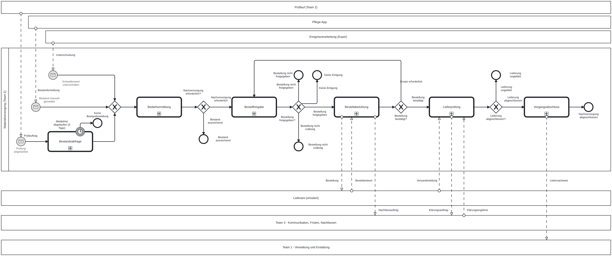

# Team 2 Materialversorgung – Erklärung des BPMN-Modells

> **KI-Kennzeichnung (Kursregel):** Modell und Text wurden mit KI-Unterstützung erstellt (Claude, Anthropic) und müssen von Team 2 geprüft werden. Jedes Teammitglied muss das gesamte Modell erklären können (Projektvorgaben). Diese Datei dient auch zur Vorbereitung auf Meilenstein und Abnahme.
>
> **Stand:** 08.11.2026 · **Technik:** CIB seven (Camunda 7), External Tasks, JUEL · **Grundlage:** Teamauftrag 2, Projekthandbuch, Integrationspaket, Vorlesung „BPMN Best Practices“

---

## 1. Kurzüberblick

**Ziel (Teamauftrag 2):** Die Anwendung behält den Vorrat ausgewählter Verbrauchsprodukte im Blick und erkennt rechtzeitig Bedarf. Sie berücksichtigt Präferenzen und Grenzen, holt Entscheidungen ein und verfolgt die Lieferung bis zur Bestätigung.

**Eine Instanz von `T2_Materialversorgung`** ist ein Nachversorgungsvorgang für **ein Produkt eines Pflegehaushalts**. Den geplanten Prüftermin übernimmt ein eigener Prozess `T2_Prueflauf`. Der Grund: Ein Prüflauf betrifft viele Vorgänge, es gibt also keine 1:1-Beziehung. Stiehl nennt das „Instance Alignment“.

| Datei | Rolle | Teamauftrag-Schritte |
|---|---|---|
| `T2_Prueflauf.bpmn` | Täglicher Prüflauf, startet je fälligem Profil einen Vorgang | (Auslöser 1) |
| `T2_Materialversorgung.bpmn` | **Hauptprozess**, 6 Call Activities | 1–12 |
| `T2_Bestandsabfrage.bpmn` | Bestand anfragen, melden, erinnern | 1 |
| `T2_Bedarfsermittlung.bpmn` | Reichweite berechnen, Bedarf feststellen | 2–3 |
| `T2_Bestellfreigabe.bpmn` | Vorschlag, Abweichungen, Berechtigungsregel, Kundenentscheidung (höchstens 3 Vorschläge) | 4–7 |
| `T2_Kundenentscheidung.bpmn` | **Gemeinsamer Baustein** für Team 1, 2 und 3 | 7 |
| `T2_Bestellabwicklung.bpmn` | Bestellung per JMS senden, Antwort abwarten, über Team 3 nachfassen | 8–9 |
| `T2_Lieferpruefung.bpmn` | Versand, Lieferprüfung, Klärung über Team 3 | 9–10 |
| `T2_Vorgangsabschluss.bpmn` | Bestand fortschreiben, Liefernachweis an Team 1, Ergebnis mitteilen | 11–12 |

---

## 2. Der Hauptprozess Schritt für Schritt

**Start (3 Auslöser laut Teamauftrag, alle als Nachrichtenstart):**

| Startereignis | Absender (Blackbox-Pool) | Nachricht | Weiter mit |
|---|---|---|---|
| Prüfung angestoßen | Prüflauf (Team 2) | `Prueflauf_Pruefauftrag_Team2` | Bestandsabfrage |
| Bestand manuell gemeldet | Pflege-App | `PflegeApp_Bestandsmeldung_Team2` | Bedarfsermittlung |
| Schwellenwert unterschritten | Ereignisverarbeitung (Esper) | `Esper_Schwellenwertunterschreitung_Team2` | Bedarfsermittlung |

**Ablauf:**
1. **Bestandsabfrage** (nur nach Prüfauftrag): Die Pflegeperson wird gefragt und nach 1 Tag erinnert. Nach 3 Tagen ohne Meldung greift der unterbrechende Timer an der Call Activity, Ende „Keine Bestandsmeldung“.
2. Ein **sammelndes XOR** führt die 3 Startwege zusammen.
3. **Bedarfsermittlung** endet mit „Nachversorgung erforderlich“ oder „Bestand ausreichend“. Bei „Bestand ausreichend“ wird die nächste Prüfung terminiert.
4. **Bestellfreigabe** endet mit einem von 4 Ergebnissen:
   - „Bestellung freigegeben“ → weiter
   - „Bestellung nicht freigegeben“ → Ende, das Reichweitenrisiko wurde mitgeteilt
   - „Bestellung nicht zulässig“ → Ende, die Prüfstelle hat abgelehnt
   - „Keine Einigung“ → Ende nach 3 Vorschlägen
5. **Bestellabwicklung** endet mit „Bestellung bestätigt“ → weiter, oder „Ersatz erforderlich“ → zurück zur Bestellfreigabe. Dort werden dann nur hinterlegte Ersatzoptionen vorgeschlagen.
6. **Lieferprüfung** endet mit „Lieferung abgeschlossen“ → weiter, oder „Lieferung ungeklärt“ → Ende, übergeben an die Prüfstelle.
7. **Vorgangsabschluss** führt zum Ende „Nachversorgung abgeschlossen“.

**Label-Matching (Stiehl, Regeln 10–12):** Jedes Endereignis eines Teilprozesses setzt per Execution Listener eine Ergebnisvariable mit seinem eigenen Namen, z. B. `bestellfreigabeErgebnis = 'Keine Einigung'`. Die Call Activity gibt sie per `camunda:out` zurück. Das Gateway prüft genau diesen Text. Beschriftung und Technik können dadurch nicht auseinanderlaufen.

---

## 3. Die Teilprozesse

| Teilprozess | Ablauf (kurz) | Rollen | Besonderheiten |
|---|---|---|---|
| **Prüflauf** | Timer täglich 6 Uhr → „Fällige Versorgungsprofile ermitteln“ → „Prüfauftrag senden“ als **parallele Mehrfachinstanz** über `faelligeProfile` | System | Leere Liste: Die Aufgabe endet sofort, es wird kein Vorgang gestartet. |
| **Bestandsabfrage** | Bestand anfragen → Benutzeraufgabe „Bestand melden“ | Pflegeperson (Bahn), Backoffice | **Nicht unterbrechender** Timer (1 Tag) löst die Erinnerung aus. Die endgültige Frist liegt im Hauptprozess. |
| **Bedarfsermittlung** | Verbrauch und Reichweite berechnen → Regelaufgabe „Nachversorgungsbedarf feststellen“ → Gateway | System | Markiert `verbrauchssprung`. Keine medizinische Bewertung. |
| **Bestellfreigabe** | Vorschlag → Abweichungen prüfen → Berechtigungsregel → einer von 3 Wegen: automatisch, Kundenfreigabe oder Prüfstelle | Backoffice, menschliche Prüfstelle (Bahn) | Bei „Änderung gewünscht“ zurück zum Vorschlag, aber höchstens 3 Vorschläge (Zähler `anzahlVorschlaege`), danach „Keine Einigung“. |
| **Kundenentscheidung** | Freigabeanfrage zustellen → „Freigabe entscheiden“ → Freigegeben, Änderung gewünscht oder Nicht freigegeben | Pflegeperson, Backoffice | Erinnerung nach 1 Tag (nicht unterbrechend). Frist 3 Tage (unterbrechend) führt zu „Nicht freigegeben“. **Wiederverwendbar** für Team 1 und 3. |
| **Bestellabwicklung** | Sendeaufgabe „Bestellung übermitteln“ (JMS) → ereignisbasiertes Gateway: Bestellantwort oder Antwortfrist | System | Bei Fristablauf einmal nachfassen über Team 3, danach „Ersatz erforderlich“. Auch Nichtverfügbarkeit führt zu „Ersatz erforderlich“. |
| **Lieferprüfung** | Empfangsaufgabe „Versandmeldung“ → „Lieferung prüfen“ (Pflegeperson) → richtig oder Abweichung | Pflegeperson, Backoffice | Abweichung, Versandfrist oder Bestätigungsfrist führen zu „Klärung beauftragen“ (Team 3), danach wird das Klärungsergebnis ausgewertet. |
| **Vorgangsabschluss** | Bestand und Verbrauch fortschreiben → Liefernachweis übergeben (Team 1) → Ergebnis mitteilen | System | Linearer Abschluss |

---

## 4. Technische Umsetzung in CIB seven (Camunda 7)

| Thema | Umsetzung im Modell |
|---|---|
| Teilprozesse | Call Activities mit `calledElementBinding="latest"`, **Call by Value** über `camunda:in`/`camunda:out` (Vorlesung 03). Der Business Key wird weitergegeben. |
| Aufgaben | Service-, Sende- und Regelaufgaben als **External Tasks** (`camunda:type="external"`, eigenes Topic `t2-…`). Benutzeraufgaben haben `candidateGroups` (`pflegeperson`, `pruefstelle`) und generierte Formulare (`camunda:formData`). |
| Benachrichtigung | Ein Topic `t2-benachrichtigung` mit Eingabeparameter `vorlage`, z. B. BESTANDSANFRAGE, FREIGABEANFRAGE, REICHWEITENRISIKO, ERGEBNIS |
| Nachrichten | Nachrichtenstarts, Nachrichten-Zwischenereignisse und eine Empfangsaufgabe mit `messageRef`. Korrelation per REST `POST /message` mit Nachrichtenname und `vorgangId`/Business Key, später über Camel. |
| Pflicht laut Projektvorgaben | Sendeaufgabe „Bestellung übermitteln“ → JMS-Queue → Camel (CBR, XML↔JSON). Rückweg „Bestellantwort empfangen“ über Camel. Esper liefert „Schwellenwert unterschritten“ (Eventing). |
| Zeiten | ISO-8601-Dauern (P1D, P3D, P5D). Der Prüflauf nutzt den Cron-Ausdruck `0 0 6 * * ?`. |
| Mehrfachinstanz | `multiInstanceLoopCharacteristics` mit `camunda:collection="${faelligeProfile}"` und `camunda:elementVariable="profil"` |
| Betrieb | `camunda:historyTimeToLive="P180D"` an jedem Prozess (Pflicht ab Camunda 7.20) |
| Prüfung | XSD (BPMN 2.0, OMG), bpmnlint, `werkzeuge/stilcheck.py`. **Kein Deploy-Test auf einer laufenden Engine bisher.** |

**Wichtige Variablen:** `pflegehaushaltId`, `vorgangId`, `produktId`, `bestandMenge`, `bestandZeitpunkt`, `nachversorgungsbedarf`, `verbrauchssprung`, `freigabeweg`, `bestellvorschlag`, `anzahlVorschlaege`, `kundenentscheidungErgebnis`, `bestellantwortStatus`, `ersatzGrund`, `lieferbefund`, `klaerungsergebnis`, die Ergebnisvariablen `…Ergebnis` sowie `faelligeProfile`/`profil`.

---

## 5. Bekannte Schwächen und wie man sie besser macht

| Nr | Schwäche | Auswirkung | Verbesserung | Wer |
|---|---|---|---|---|
| S1 | **Doppelte Vorgänge möglich:** Eine Bestandsmeldung aus der App kann zusätzlich bei Esper eine Unterschreitung auslösen. Auch der Prüflauf kann ein Profil mit offenem Vorgang erneut starten. | Zwei Instanzen für dasselbe Produkt, doppelte Bestellung | Beim Start prüfen, ob ein offener Vorgang je Haushalt und Produkt existiert (Business Key `PH-…:Produkt`, Abfrage vor dem Start oder Nachricht an die laufende Instanz korrelieren). Esper nur auf Verbrauchsprognosen reagieren lassen. | Team 2 |
| S2 | **Benachrichtigung und Berechtigungsprüfung** sind nur Topics und keine eigenständig aufrufbaren Bausteine. Die Berechtigungsregel ist auf Bestellungen zugeschnitten. | Teamauftrag 2.2 verlangt Nutzbarkeit durch Team 1 und 3 | Eigene DMN „Berechtigungsregel“ mit allgemeinen Eingaben (Handlung, Betrag, Abweichungsart). Benachrichtigung als REST-Service oder Call Activity anbieten. | Team 2 + Integrationskreis |
| S3 | **Fristen doppelt bzw. lückenhaft:** Für das Nachfassen hat Team 2 eigene Timer, obwohl Team 3 Fristen führt. Bei der Klärung fehlt eine eigene Frist. | Vorgang kann offen bleiben (Handbuch 5.4) oder es wird doppelt nachgefasst | Klären, wer die Frist führt. Falls Team 3: Rückmeldung „Nachfassergebnis/Zeitüberschreitung“ auswerten. In jedem Fall einen Sicherheits-Timer an „Klärungsergebnis empfangen“ (ereignisbasiertes Gateway). | Integrationskreis |
| S4 | **Kunde nicht bei jedem Ende informiert:** Bei „Keine Einigung“, „Bestellung nicht zulässig“, „Keine Bestandsmeldung“ und „Lieferung ungeklärt“ fehlt die Mitteilung. | Teamauftrag Schritt 12: Ergebnis dem Kunden anzeigen | Vor diesen Endereignissen „Ergebnis mitteilen“ einbauen oder per End-Listener die gemeinsame Benachrichtigung aufrufen. | Team 2 |
| S5 | **Gemeinsame Vorgangszustände** (Handbuch 7.2, z. B. „Wartet auf Kunde“) werden nicht gesetzt. | Die Oberfläche kann den Zustand nicht anzeigen | Execution Listener an Start, Benutzeraufgaben, Wartepunkten und Endereignissen setzen `vorgangszustand` und melden ihn an die Vorgangsübersicht von Team 1. | Team 2 + Team 1 |
| S6 | **Technische Ausnahmen fehlen:** kein Fehlerweg, wenn die Gegenkomponente nicht verfügbar ist, kein Schutz gegen doppelte Ereignisse (Integrationspaket 8.3). | Nur Incident in Cockpit, keine fachliche Reaktion | Error-Boundary-Event „Übermittlung fehlgeschlagen“ an Sendeaufgaben (Worker meldet `handleBpmnError`). Retries konfigurieren. `ereignisId` beim Empfang auf Duplikate prüfen. | Team 2 |
| S7 | **Keine Transaktionsgrenzen** (`camunda:asyncBefore`/`asyncAfter`) | Bei Fehlern rollt die Engine bis zum letzten Wartezustand zurück, z. B. bis zum Nachrichtenstart | `asyncBefore` an Nachrichtenstarts und vor Call Activities setzen. | Team 2 |
| S8 | **Keine Default-Flüsse** an Gateways | Unerwarteter Wert führt zum Incident „no outgoing sequence flow“ | Default-Fluss zu einem Klärungsweg oder bewusst Incident lassen und dokumentieren | Team 2 |
| S9 | **Keine Quittung von Team 1** auf den Liefernachweis | Fehlerantwort (Integrationspaket 7.3) wird nicht verarbeitet | Antwort „Dokument eingegangen“ oder Fehler abwarten (Nachrichtenereignis mit Frist) | Team 1 + 2 |
| S10 | **Pflegeperson uneinheitlich:** im Hauptprozess über den Pool „Pflege-App“, in den Teilprozessen als Bahn | Kann als Stilbruch gelten | Offene Frage an Stiehl (siehe 7) | Stiehl |
| S11 | **Keine Datenobjekte und Datenspeicher** im Diagramm | Datenfluss nur in der Doku sichtbar | Datenspeicher „Versorgungsprofil“ und „Bestellung“ einzeichnen (wie im Vergleichsprojekt) | Team 2 |
| S12 | **Fristen fest im Modell** (P1D, P3D …) | Nicht konfigurierbar (Handbuch 5.6) | Fristen aus DMN „Fristen“ oder Konfiguration lesen (`${fristBestand}`) | Team 2 |

---

## 6. Offene Punkte – im Integrationskreis abstimmen

- Gemeinsame Kennungen (`PH-…`, `VG-T2-…`, `korrelationsId`) und der Ereignisrahmen (Integrationspaket 6.5)
- Eine gemeinsame CIB-seven-Engine für alle 3 Teams oder getrennte Engines? Davon hängt ab, ob die Kundenentscheidung als Call Activity oder per Nachricht aufgerufen wird.
- Inhalt und Antwort von Nachfassauftrag und Klärungsauftrag (Team 3) sowie Liefernachweis (Team 1)
- Wer führt welche Frist (S3)?
- Gemeinsamer Testhaushalt (PH-0001 Bergmann, Testprodukt M) mit konkreten Werten
- Wer baut die Pflege-App bzw. gemeinsame Oberfläche?

---

## 7. Offene Fragen

### 7.1 An Prof. Stiehl (Meilenstein 09.11.2026)
| Nr | Frage | Unser Vorschlag |
|---|---|---|
| F1 | Pflegeperson als **Bahn** im eigenen Pool oder als **eigener Pool**? | Bahn für ihre Benutzeraufgaben, „Pflege-App“ als Blackbox für eingehende Meldungen |
| F2 | Ist der **eigene Prüflauf-Prozess** (Timer + Mehrfachinstanz → je Profil ein Nachrichtenstart) die richtige Lösung für die Instanz-Ausrichtung? | Ja, nach dem Muster „getrennte Pools bei fehlender 1:1-Beziehung“ aus den Best Practices |
| F3 | Sammelndes XOR vor einer Aufgabe (bei 3 Linien) oder streng **Regel 19**? | XOR nur bei 3 und mehr Linien, sonst direkt |

### 7.2 Technische Fragen (an Stiehl bzw. Integrationskreis)
| Nr | Frage | Warum wichtig |
|---|---|---|
| T1 | **Wie werden Nachrichten in die Engine korreliert:** Camel ruft die REST-API `POST /engine-rest/message` auf, oder eigener Quarkus-Endpunkt mit Java-API? | Betrifft alle Nachrichtenstarts und Zwischenereignisse |
| T2 | **Worker-Technik:** External-Task-Client in Quarkus (Java) oder in einer anderen Sprache? Darf ein fertiger Client genutzt werden? | Projektvorgaben: Frameworks mit dem Dozenten absprechen |
| T3 | **Esper-Anbindung:** Welche Ereignisse bekommt Esper (Bestandsmeldungen, Verbrauch), und wie meldet es die Unterschreitung (JMS → Camel → Prozess)? | Pflichtpunkt Eventing |
| T4 | **JMS-Queues und CBR-Ziele:** Welche Queue-Namen, wohin routet Camel (Datei, DB-Tabelle), welches Format (XML oder JSON)? | Pflichtpunkt Messaging und Integration |
| T5 | **Persistenz:** eigenes MySQL-Schema je Team oder gemeinsames Datenmodell (Pflegehaushalt von Team 1)? | Team 1 verantwortet das Grundmodell |
| T6 | **Deployment:** ein gemeinsames Deployment mit allen BPMN- und DMN-Dateien oder je Team? Gibt es Mandanten (Multi-Tenancy)? | Namenskonflikte bei Prozess-IDs und Nachrichtennamen |
| T7 | Sollen **Fristen konfigurierbar** sein (DMN) oder reichen feste Werte für das MVP? | Handbuch 5.6 |
| T8 | Wie werden **Benutzeraufgaben** bearbeitet: CIB-seven-Tasklist mit generierten Formularen oder eigene Oberfläche? | Aufwand der UI |

---

## 8. Mögliche Prüfungsfragen (technisch) – mit Kurzantwort

| Frage | Kurzantwort |
|---|---|
| Warum Call Activities statt eingebetteter Teilprozesse? | Eigene Dateien, wiederverwendbar (Kundenentscheidung für alle Teams), eigene Versionierung. Datenübergabe Call by Value, also nur über In/Out-Mapping. |
| Was ist der Unterschied zwischen Call by Value und Call by Reference? | Bei Call by Value (Call Activity) sieht der Kindprozess nur gemappte Kopien. Bei Call by Reference (eingebetteter Teilprozess) sieht er die Variablen des Elternprozesses und kann sie ändern. |
| Wie stellt ihr Label-Matching sicher? | Endereignis-Listener setzt `<teilprozess>Ergebnis` = Name des Endereignisses. Out-Mapping gibt ihn zurück, das Gateway prüft genau diesen Text. |
| Wozu dient das ereignisbasierte Gateway in der Bestellabwicklung? | Es wartet auf das erste von mehreren Ereignissen: Bestellantwort (Nachricht) oder Antwortfrist (Timer). Der Gewinner bestimmt den Weg. |
| Unterbrechender vs. nicht unterbrechender Timer? | Nicht unterbrechend: Die Aufgabe bleibt aktiv, zusätzlich startet ein paralleler Pfad (Erinnerung). Unterbrechend: Die Aufgabe bzw. der Teilprozess wird abgebrochen (endgültige Frist). |
| Warum ein eigener Prüflauf-Prozess? | Ein Prüflauf betrifft viele Vorgänge, also keine 1:1-Beziehung. Deshalb ein eigener Prozess, der je Profil per Nachricht genau eine Instanz startet (Instance Alignment). |
| Wie wird eine Nachricht der richtigen Instanz zugeordnet? | Über den Nachrichtennamen und eine Korrelation (Business Key bzw. `vorgangId`). Ein Nachrichtenstart erzeugt dagegen eine neue Instanz. |
| Was passiert, wenn ein Worker ausfällt? | Der External Task bleibt offen, wird nach Ablauf des Locks erneut geholt (Retries) und wird bei 0 Retries zum Incident im Cockpit. Fachlicher Fehler: `handleBpmnError` mit Error-Boundary-Event (siehe S6). |
| Warum External Tasks statt Java Delegates? | Lose Kopplung: Die Worker laufen getrennt von der Engine (z. B. Quarkus-Services), sind austauschbar und skalierbar, gut für simulierte Dienste. |
| Wie sieht die Variablen-Sichtbarkeit aus? | Elternvariablen sind im Kind-Scope sichtbar, aber nicht umgekehrt. `setVariable` sucht von innen nach außen, `setVariableLocal` schreibt lokal (Vorlesung 04a). |
| Wo entscheidet ein Gateway? | Nie. Davor erzeugt immer eine Aufgabe oder Regel das Ergebnis (Regel 20), das Gateway prüft nur Daten. |
| Wozu `historyTimeToLive`? | Seit Camunda 7.20 Pflicht: Nach dieser Zeit darf die Engine die History der beendeten Instanzen löschen. |
| Wie erfüllt ihr Messaging, Integration und Eventing? | Sendeaufgabe → JMS-Queue → Camel (CBR, XML↔JSON) → simulierter Lieferant. Rückweg über Camel zum Nachrichten-Zwischenereignis. Esper erkennt die Unterschreitung → Nachrichtenstart. |
| Warum höchstens 3 Vorschläge? | Damit es keine Endlosschleife zwischen Kunde und System gibt. Ein definiertes Ende „Keine Einigung“ (Projektannahme). |
