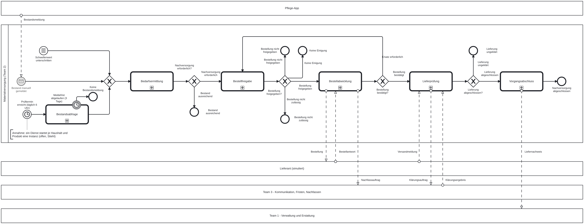

# Team 2 – Materialversorgung: BPMN-Modell

> **KI-Kennzeichnung (Kursregel):** Modelle, Bilder und dieser Text wurden mit KI-Unterstützung erstellt (Claude, Anthropic) und müssen von Team 2 geprüft werden. Wer im Team welchen Teil verantwortet, ist noch offen. Das Team trägt es in die `documentation` der Prozesse und hier ein.
>
> **Stand:** 08.11.2026 (Abend). **Grundlage:** Teamauftrag 2, Gemeinsames Projekthandbuch, Integrations- und Organisationspaket (alle v1.0, 20.10.2026) und die Vorlesung „BPMN Best Practices“ (Method & Style). **Technik:** CIB seven (Camunda 7), External Tasks, JUEL. DMN, Simulator und Tests kommen später.

## Überblick

| Datei | Inhalt | Teamauftrag-Schritte |
|---|---|---|
| `T2_Materialversorgung.bpmn` | **Hauptprozess** (6 Call Activities, 3 Starts, 7 Endzustände) | 1–12 |
| `T2_Bestandsabfrage.bpmn` | Bestand anfragen, melden, erinnern | 1 |
| `T2_Bedarfsermittlung.bpmn` | Reichweite berechnen, Bedarf feststellen | 2–3 |
| `T2_Bestellfreigabe.bpmn` | Vorschlag, Abweichungen, Berechtigungsregel, Kundenentscheidung | 4–7 |
| `T2_Kundenentscheidung.bpmn` | **Gemeinsamer Baustein** für Team 1, 2 und 3 | 7 |
| `T2_Bestellabwicklung.bpmn` | Bestellung senden (JMS), Antwort abwarten, Nachfassen | 8–9 |
| `T2_Lieferpruefung.bpmn` | Versand, Lieferprüfung, Klärung von Abweichungen | 9–10 |
| `T2_Vorgangsabschluss.bpmn` | Bestand fortschreiben, Nachweis an Team 1, Ergebnis mitteilen | 11–12 |

Eine Instanz entspricht einem Nachversorgungsvorgang für ein Produkt eines Pflegehaushalts. Diese Instanz-Definition ist eine Projektannahme und muss im Integrationskreis bestätigt werden.



## Prozessgrenze
- **Start (3 Auslöser laut Teamauftrag):**
  - Timer „Prüftermin erreicht“ (geplanter Termin)
  - Nachrichtenstart „Bestand manuell gemeldet“ (Nachricht `Bestandsmeldung` aus dem Blackbox-Pool „Pflege-App“)
  - Bedingungsstart „Schwellenwert unterschritten“
- **Endzustände (Hauptprozess):**

| Endereignis | Gemeinsamer Vorgangszustand (Handbuch 7.2) |
|---|---|
| Nachversorgung abgeschlossen | Erfolgreich abgeschlossen |
| Bestand ausreichend | Erfolgreich abgeschlossen (nächste Prüfung terminiert) |
| Keine Bestandsmeldung | Abgebrochen |
| Bestellung nicht freigegeben | Erfolglos abgeschlossen (Reichweitenrisiko mitgeteilt) |
| Bestellung nicht zulässig | Erfolglos abgeschlossen (Begründung der Prüfstelle) |
| Keine Einigung | Erfolglos abgeschlossen (nach 3 Vorschlägen keine Freigabe) |
| Lieferung ungeklärt | Übergeben (an die menschliche Prüfstelle) |

Die Zuordnung zu den Zuständen ist ein Vorschlag für den Integrationskreis.

## Pflicht-Ausnahmen (Teamauftrag Abschnitt 5) – alle 8 modelliert

| Situation | Wo im Modell |
|---|---|
| Bestand nicht gemeldet | Bestandsabfrage: Erinnerung als nicht unterbrechender Timer; endgültige Frist als unterbrechender Timer an der Call Activity im Hauptprozess |
| Verbrauch deutlich verändert | Bedarfsermittlung markiert `verbrauchssprung` → Bestellfreigabe: Abweichung → Kundenfreigabe (keine stille Mengenerhöhung) |
| Preisgrenze überschritten | Bestellfreigabe: „Abweichungen prüfen“ + „Berechtigungsregel anwenden“ → Kundenentscheidung |
| Bevorzugtes Produkt nicht verfügbar | Bestellabwicklung → „Ersatz erforderlich“ → zurück zur Bestellfreigabe, nur hinterlegte Ersatzoptionen |
| Lieferant antwortet nicht | Bestellabwicklung: Antwortfrist → Nachfassen über Team 3 → nach erneuter Frist „Ersatz erforderlich“ |
| Teil- oder Falschlieferung | Lieferprüfung: „Abweichung festgestellt“ → Klärung über Team 3, Status bleibt offen |
| Kunde lehnt ab oder verschiebt | Kundenentscheidung „Nicht freigegeben“ → „Reichweitenrisiko mitteilen“, keine Bestellung |
| *(Ergänzung)* Kunde wünscht immer wieder Änderungen | Bestellfreigabe: höchstens 3 Vorschläge, danach Ende „Keine Einigung“ |
| Lieferung bleibt unbestätigt | Lieferprüfung: Bestätigungsfrist → Klärung, sonst „Lieferung ungeklärt“, nie automatisch erfolgreich |

## Umgesetzte Best Practices (Stiehl, Method & Style)
- **Methode top-down:** Hauptprozess mit höchstens 10 Aktivitäten. Jeder Teilprozess liegt als eigene Datei vor (Call Activity, Call by Value mit `camunda:in`/`camunda:out`).
- **Label-Matching (Regeln 10–12):** Die Endereignisse jedes Teilprozesses heißen genau wie die Ausgänge des folgenden Gateways. Jedes Endereignis setzt per Execution Listener `<teilprozess>Ergebnis = '<Name des Endereignisses>'`, und das Gateway prüft genau diesen Text.
- **Nachrichtenflüsse:** Sie sind in Eltern- und Kindebene gleich beschriftet (Regel 14). Jede Sende- und Empfangsaufgabe hat einen Nachrichtenfluss (Regel 13). Partner sind Blackbox-Pools (Regel 3).
- **Rollen als Lanes:** Pflegeperson und menschliche Prüfstelle sind Lanes im eigenen Pool (Regel 5). Organisationen (Lieferant, Team 1, Team 3) sind eigene Pools.
- **Benennung:** Aktivitäten nach Objekt + Verb, Ereignisse nach Objekt + Partizip, Endzustände getrennt und eindeutig (Regeln 7, 8, 16, 17). Gateways sind als Frage benannt, alle Ausgänge beschriftet.
- **Gateway entscheidet nicht (Regel 20):** Davor liegt immer eine Aufgabe oder Regel, die das Ergebnis erzeugt.
- **Warten mit Erinnern:** nicht unterbrechender Timer an der Aufgabe, endgültige Frist als unterbrechender Timer. „Keine Antwort“ ist nie eine Freigabe.
- **Integration grau markiert:** Senden, Empfangen, Aufträge an andere Teams.
- **Pflichtpunkte aus den Projektvorgaben:** Sendeaufgabe „Bestellung übermitteln“ schreibt in eine JMS-Queue (Camel/CBR). Nachrichten-Zwischenereignis „Bestellantwort empfangen“ empfängt die Backend-Antwort über Camel.
- **Bewusste Abweichung von Regel 19:** Ein sammelndes XOR steht vor „Bedarfsermittlung“ (3 Starts) und vor „Klärung beauftragen“ (3 Auslöser). Grund ist unsere Projektregel: höchstens 2 Linien in eine Aufgabe.

## Schnittstellen – nur Vorschlag, im Integrationskreis abstimmen

| Richtung | Nachricht / Funktion | Element |
|---|---|---|
| Pflege-App → Team 2 | `PflegeApp_Bestandsmeldung_Team2` (manuelle Bestandsmeldung) | Nachrichtenstart im Hauptprozess |
| Team 2 → Lieferant (simuliert) | `Bestellung` (JMS) | Sendeaufgabe, Topic `t2-bestellung-senden` |
| Lieferant → Team 2 | `Lieferant_Bestellantwort_Team2` (Status `BESTAETIGT`/`NICHT_VERFUEGBAR`) | Nachrichten-Zwischenereignis |
| Lieferant → Team 2 | `Lieferant_Versandmeldung_Team2` | Empfangsaufgabe |
| Team 2 → Team 3 | Nachfassauftrag (Gegenstelle, Nachricht, Antwortfrist, Nachfassregel) | Topic `t2-nachfassen-beauftragen` |
| Team 2 → Team 3 | Klärungsauftrag (Abweichung, Gegenstelle) | Topic `t2-klaerung-beauftragen` |
| Team 3 → Team 2 | `Team3_Klaerungsergebnis_Team2` (`klaerungsergebnis`) | Nachrichten-Zwischenereignis |
| Team 2 → Team 1 | Liefernachweis (Pflegehaushalt, Bestellung, Herkunft, Ergebnis) | Topic `t2-nachweis-uebergeben` |
| Team 2 → Team 1/3 | **Kundenentscheidung** als Call Activity `T2_Kundenentscheidung` (Ein: `freigabeHandlung`, `freigabeBegruendung`, `freigabeFolgen`, `freigabeGueltigBis`; Aus: `kundenentscheidungErgebnis`, `kundenentscheidungKommentar`) | eigener Prozess |
| Team 2 → alle | Benachrichtigung (Topic `t2-benachrichtigung`, Parameter `vorlage`), Berechtigungsprüfung (`t2-berechtigung-pruefen`, später DMN) | Service-/Regelaufgaben |

Jede teamübergreifende Nachricht soll den gemeinsamen Ereignisrahmen tragen (Integrationspaket 6.5): `ereignisId`, `ereignistyp`, `zeitpunkt`, `quelle`, `pflegehaushaltId`, `vorgangId`, `korrelationsId`, `schemaVersion`, `nutzdaten`.

## Projektannahmen – nicht von Stiehl vorgegeben
- Fristen: Erinnerung 1 Tag, Meldefrist 3 Tage, Antwortfrist Kunde 3 Tage, Antwortfrist Lieferant 1 Tag (einmal nachfassen), Versandfrist 5 Tage, Bestätigungsfrist 3 Tage. Prüftermin täglich um 6 Uhr. Die Werte werden später konfigurierbar (DMN „Fristen“).
- Höchstens 3 Vorschläge je Bestellfreigabe (Zähler `anzahlVorschlaege`), danach Ende „Keine Einigung“.
- Timer-Start: Ein Dienst startet je Haushalt und Produkt eine Instanz (Anmerkung am Timer-Start, offen bei Stiehl).
- Bei Ausbleiben der Lieferanten-Antwort wird einmal über Team 3 nachgefasst, danach gilt „Ersatz erforderlich“.
- Fristen der Klärung führt Team 3 (gemeinsamer Baustein). Team 2 wartet auf das Klärungsergebnis.

## Offene Fragen für den Meilenstein (09.11.2026)

| Nr | Frage | Unser Vorschlag | Begründung |
|---|---|---|---|
| 1 | **Pflegeperson als Bahn (Lane) oder als eigener Pool?** | Bahn im eigenen Pool für ihre Aufgaben (Bestand melden, Freigabe entscheiden, Lieferung prüfen). Die App, über die sie Meldungen schickt, wird im Hauptprozess als Blackbox-Pool „Pflege-App“ gezeigt. | Teamauftrag 4.1: Kundenentscheidungen werden als menschliche Aufgaben modelliert. Diese Aufgaben laufen in unserer Engine (Tasklist), also gehören sie in unseren Pool (Stiehl, Regel 5). Eigene Pools sind laut Regel 3 für externe Organisationen gedacht. |
| 2 | **Timer-Start: Wie entsteht je Haushalt und Produkt eine Instanz?** | Ein Dienst prüft täglich um 6 Uhr alle fälligen Versorgungsprofile und startet je Haushalt und Produkt eine eigene Instanz. Im Modell steht das als Anmerkung am Timer-Start. | Ein Timer-Start allein erzeugt nur eine Instanz pro Zeitpunkt. Die 1:1-Zuordnung Instanz = Vorgang (Handbuch 5.2, Method & Style „Instance Alignment“) braucht deshalb einen Startdienst. |
| 3 | **Sammelndes XOR vor einer Aufgabe oder Stiehls Regel 19?** | Sammelndes XOR beibehalten, wo 3 Linien zusammenkommen (vor „Bedarfsermittlung“ und „Klärung beauftragen“). Bei höchstens 2 Linien führen sie direkt in die Aufgabe, ganz nach Regel 19. | Unsere Projektregel erlaubt höchstens 2 Linien in eine Aufgabe, damit das Bild lesbar bleibt. Regel 19 empfiehlt direkte Linien ohne XOR. Wir bitten Stiehl um Bestätigung, welche Variante er bewertet. |

## Offen (Stiehl/Integrationskreis)
- Instanz-Definition, gemeinsame Kennungen (`PH-…`, `VG-T2-…`) und Nachrichtenformate
- Ob Team 3 auch ein „Nachfassergebnis“ an Team 2 zurückmeldet (aktuell: Antwort kommt direkt als Bestellantwort)
- Wie Team 1 und 3 die Kundenentscheidung aufrufen: Call Activity in derselben Engine oder per Nachricht
- Was zum Meilenstein am 09.11.2026 konkret gezeigt werden muss

## Prüfung (08.11.2026)
- XSD-Prüfung gegen das offizielle BPMN-2.0-Schema: 8/8 gültig (Elementreihenfolge)
- bpmnlint (recommended): 0 Fehler. Die Hinweise „fake-join“ sind gewollt (2 Linien direkt in eine Aufgabe, Regel 19).
- Eigener Stilcheck (`werkzeuge/stilcheck.py`): Label-Matching, Nachrichtenflüsse Eltern/Kind, höchstens 10 Aktivitäten, höchstens 2 eingehende Linien, Camunda-Pflichtattribute → keine Fehler
- **Noch nicht gemacht:** Deploy auf einer laufenden CIB-seven-Engine. Bitte lokal prüfen:

```bash
cd prozesse/team2
curl -s -X POST http://localhost:8080/engine-rest/deployment/create \
  -F deployment-name=team2-bpmn -F enable-duplicate-filtering=true \
  $(for f in *.bpmn; do echo -n "-F $f=@$f "; done)
```
